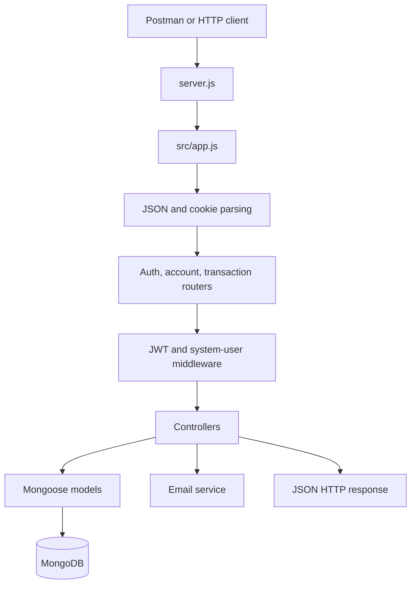

# Ledger Backend

A JavaScript/Node.js backend for user accounts and ledger-based transfers. Account balances are derived from immutable-style debit and credit ledger entries rather than stored as a mutable balance field.

## Problem and features

The application models users, accounts, transfers, and ledger entries in MongoDB. It implements:

- User registration and login with bcrypt password hashing and JWTs.
- Logout by clearing the token cookie and blacklisting the token.
- Multiple accounts per user, account listing, and balance lookup.
- Transfers represented by one transaction and debit/credit ledger entries.
- Idempotency-key lookup for regular transfer retries.
- A system-user-only initial-funding route.
- Registration and transaction email attempts using Nodemailer/Gmail OAuth2.

This is a learning/project backend, not a production-ready banking system.

## Technology

- Node.js and CommonJS JavaScript
- Express 5
- MongoDB with Mongoose
- `bcryptjs`, `jsonwebtoken`, and `cookie-parser`
- `dotenv`, `chalk`, and `nodemailer`
- Nodemon through the `dev` script

## Architecture



The server loads environment variables, starts the MongoDB connection, and listens on `PORT`. Express parses JSON and cookies, dispatches requests to routers, and protected routes authenticate before controller logic. Controllers call Mongoose models and return JSON responses.

For regular transfers, the controller updates the sender's Mongoose version key within the MongoDB session before checking the ledger-derived balance. This creates a shared write-conflict point for concurrent transfers from the same account; the transaction and its debit/credit ledger entries are then written in that session.

## Project structure

```text
07_bank/
├── server.js
├── package.json
├── src/
│   ├── app.js
│   ├── config/db.js
│   ├── controllers/
│   ├── middlewares/auth.middleware.js
│   ├── models/
│   ├── routes/
│   └── services/email.service.js
├── docs/
├── postman/
└── test/
```

## Data model overview

- **User:** email, name, password hash, and `systemUser` flag.
- **Account:** owning user, status, and currency. No stored balance field.
- **Transaction:** source/destination accounts, amount, status, and idempotency key.
- **Ledger:** account, amount, transaction reference, and `CREDIT`/`DEBIT` type.
- **Token blacklist:** revoked token and creation time, with a three-day TTL index.

See [docs/DATABASE.md](docs/DATABASE.md) for fields, validation, references, and indexes. [docs/TECHNICAL_OVERVIEW.md](docs/TECHNICAL_OVERVIEW.md) explains the backend concepts used in the implementation.

## API summary

| Method | Endpoint | Purpose |
|---|---|---|
| POST | `/api/auth/register` | Register a user |
| POST | `/api/auth/login` | Log in |
| POST | `/api/auth/logout` | Clear and blacklist a supplied token |
| POST | `/api/accounts/` | Create an account for the authenticated user |
| GET | `/api/accounts/` | List the authenticated user's accounts |
| GET | `/api/accounts/balance/:accountId` | Calculate an account balance |
| POST | `/api/transactions/` | Transfer between accounts |
| POST | `/api/transactions/system/initial-fund` | System-user-only initial funding |

Protected routes accept a `token` cookie or an `Authorization: Bearer <token>` header. The system initial-funding route additionally requires a system user. Full request and response details are in [docs/API_DOCUMENTATION.md](docs/API_DOCUMENTATION.md).

## Environment variables

Variable names used by the source:

- `PORT`
- `MONGO_URI`
- `JWT_SECRET`
- `EMAIL_USER`
- `CLIENT_ID`
- `CLIENT_SECRET`
- `REFRESH_TOKEN`

The email service reads `EMAIL_USER`; it was not among the variable names present in the inspected `.env`. Configure values locally and never commit real credentials. The application does not provide a startup validator for all variables.

## Local setup

1. Install a Node.js version compatible with the dependencies.
2. From this directory, install the locked dependencies:

   ```sh
   npm ci
   ```

3. Configure the environment variables above in a local `.env` file. Keep database credentials, JWT secrets, and email credentials private.
4. Ensure MongoDB is available. The regular transfer flow uses MongoDB sessions/transactions, which require a transaction-capable MongoDB deployment.
5. Start the server directly:

   ```sh
   node server.js
   ```

`npm run dev` is also defined, but it invokes `npx nodemon server.js`; `nodemon` is not declared in `package.json` or the lockfile, so `npx` may try to retrieve it. Startup logs report the server and database connection; because the database connection is not awaited before `app.listen()`, their order can vary.

## Tests and Postman

There is no external automated-test framework installed. Focused tests use Node.js's built-in `node:test` runner and mocked database operations; run them with `node --test`. The existing `npm test` script remains a placeholder that exits with an error. See [docs/TESTING.md](docs/TESTING.md) for test scope and limitations.

Import [postman/ledger-backend.postman_collection.json](postman/ledger-backend.postman_collection.json) and the environment template [postman/ledger-backend.postman_environment.json](postman/ledger-backend.postman_environment.json). Replace placeholders locally. Run requests only against an isolated test database; registration, account creation, logout, and transfers write persistent data. A system user and its account must be provisioned outside the public API before initial funding can be tested.

## Known limitations

- No health-check, transaction-history, account-update, or account-delete endpoint.
- No custom centralized error or not-found response middleware.
- Automated coverage is currently limited to focused mocked controller tests; the existing `test` script is still a placeholder.
- System-user provisioning is not exposed as an API.
- The initial-funding route does not check source balance/status or perform the regular transfer's idempotency lookup.
- The regular transfer response uses the in-memory transaction created as `PENDING`, even after updating the database record to `COMPLETED`.
- A conflicting concurrent transfer is aborted and returned as a generic `500`; it is not retried automatically.
- Cookie security options and centralized environment validation are not configured in the inspected source.
- Monetary amounts use JavaScript/Mongoose `Number`.
- The blacklist schema spells its `unique` option as `unqiue`.

## Future improvements

Expand isolated automated tests, add centralized validation and error handling, add health/read APIs as needed, improve transaction/idempotency retry handling, secure cookie options, explicit environment validation, and an exact monetary representation.
