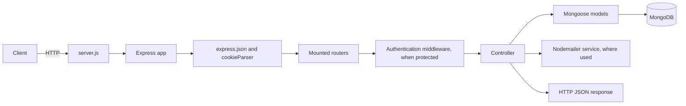

# Architecture

## Overview

The application is a CommonJS Node.js service. `server.js` loads dotenv configuration, calls the MongoDB connection helper, and starts the Express listener. `src/app.js` configures Express middleware and mounts three routers.

## Components

- **`server.js`:** Calls `dotenv.config()`, imports the app and database helper, invokes `connectDb()`, and listens on `process.env.PORT`.
- **`src/app.js`:** Creates the Express app, installs JSON and cookie parsing, and mounts auth, account, and transaction routers at `/api/auth`, `/api/accounts`, and `/api/transactions`.
- **`src/config/db.js`:** Awaits `mongoose.connect(process.env.MONGO_URI)`. On failure it logs the error and exits the process.
- **`src/routes/`:** Maps HTTP methods and paths to controller functions. Account routes require `authMiddleware`; regular transfers require it; initial funding requires `systemUserMiddleware`.
- **`src/middlewares/auth.middleware.js`:** Reads a token from the cookie or Authorization header, checks the blacklist, verifies the JWT, loads the user, and attaches it to `req.user`. The system variant also checks `systemUser`.
- **`src/controllers/`:** Coordinates request validation, model queries, email calls, and HTTP responses.
- **`src/models/`:** Defines Mongoose schemas, hooks, methods, indexes, and database operations.
- **`src/services/email.service.js`:** Configures Nodemailer/Gmail OAuth2 and exposes registration, transaction-success, and transaction-failure email functions.

## Request-response lifecycle

1. A client sends an HTTP request to the server's `PORT`.
2. Express runs middleware in registration order: JSON parsing, then cookie parsing.
3. Express matches a mounted router and route.
4. Any route middleware runs before the controller. Protected routes authenticate the JWT; initial funding also checks the system-user flag.
5. The controller reads `req.body`, `req.params`, `req.headers`, `req.cookies`, and/or `req.user`.
6. The controller performs Mongoose reads/writes and may call the email service.
7. The controller sends a status and JSON body using `res`.

No custom application-level 404 or centralized JSON error middleware is registered in `src/app.js`.

## Database interaction

Mongoose models map to MongoDB collections. ObjectId references connect users to accounts, accounts to ledger entries, and transactions to both accounts and ledger entries. These references are stored IDs; they are not database-enforced foreign keys.

The regular transfer controller:

1. Reads source and destination accounts and checks the idempotency key.
2. Checks account status and starts a Mongoose session/transaction.
3. In the session, increments the sender account's version key and calculates the sender balance from ledger entries.
4. Creates a pending transaction and debit/credit ledger documents in the session.
5. Updates the transaction status to completed and commits.
6. Attempts a success email after commit.

The sender-account write inside each transfer transaction provides a shared write-conflict point. Concurrent transfers from the same account cannot both commit based on the same ledger snapshot: a conflicting transaction aborts rather than committing a second spend. The current controller does not retry such a conflict automatically.

The initial-funding controller uses a session to create a debit and credit ledger entry, save a completed transaction, and commit. It does not use the same idempotency lookup/check sequence as the regular transfer handler.

## Operational observations

- `connectDb()` is invoked without `await` before `app.listen()`, so the HTTP listener can start while connection setup is pending.
- MongoDB transaction support is required for transfer flows using sessions.
- Email transporter verification happens when the email service is loaded.
- There is no dedicated health endpoint.
