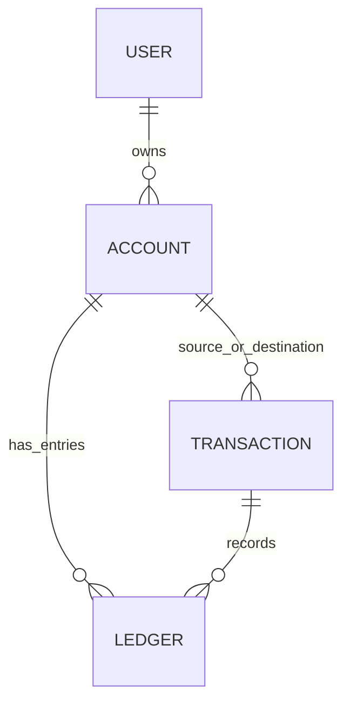

# Database

MongoDB is accessed through Mongoose. Schemas use timestamps where noted. Mongoose `ref` fields store ObjectId references; they do not create relational foreign-key constraints.

## Collections and fields

### User (`user`)

Defined in `src/models/user.model.js`.

| Field | Type/rules | Notes |
|---|---|---|
| `email` | String, required, trim, lowercase, regex match, unique | Email format regex is defined in the schema. `unique` relies on a MongoDB index, not a normal Mongoose validator. |
| `name` | String, required | User display name. |
| `password` | String, required, minimum length 6, `select: false` | Pre-save hook attempts bcrypt hashing when modified. |
| `systemUser` | Boolean, default `false`, immutable, `select: false` | System-user middleware explicitly selects this field. |
| `createdAt`, `updatedAt` | Dates | Added by timestamps option. |

The model defines `comparePassword()` using bcrypt. The pre-save hook is written with an async callback and `next`; when the password is not modified it returns `next` without calling it.

### Account (`account`)

Defined in `src/models/account.model.js`.

| Field | Type/rules | Notes |
|---|---|---|
| `user` | ObjectId ref `user`, required, indexed | Owning user. |
| `status` | String enum `ACTIVE`, `FROZEN`, `CLOSED`; default `ACTIVE` | Used by regular transfers. |
| `currency` | String, required, default `INR` | No multi-currency conversion logic is present. |
| `createdAt`, `updatedAt` | Dates | Added by timestamps option. |

No balance field exists. `getBalance()` aggregates associated ledger entries: total credits minus total debits; no entries yields zero.
The schema retains Mongoose's default `__v` version key. The regular transfer flow increments it in the transaction before reading the ledger balance, providing a shared write-conflict point for concurrent transfers from the same account.

### Transaction (`transaction`)

Defined in `src/models/transaction.model.js`.

| Field | Type/rules | Notes |
|---|---|---|
| `fromAccount` | ObjectId ref `account`, required, indexed | Source account. |
| `toAccount` | ObjectId ref `account`, required, indexed | Destination account. |
| `status` | Enum `PENDING`, `COMPLETED`, `FAILED`, `REVERSED`; default `PENDING` | Regular transfer changes status in its session. |
| `amount` | Number, required, minimum 0 | Uses JavaScript/Mongoose Number. |
| `idempotencyKey` | String, required, indexed, unique | Regular transfer checks it before writing. |
| `createdAt`, `updatedAt` | Dates | Added by timestamps option. |

### Ledger (`ledger`)

Defined in `src/models/ledger.model.js`.

| Field | Type/rules | Notes |
|---|---|---|
| `account` | ObjectId ref `account`, required, indexed, immutable | Account affected. |
| `amount` | Number, required, immutable | Amount of this ledger movement. |
| `transaction` | ObjectId ref `transaction` | Not marked required in the schema. |
| `type` | Enum `CREDIT`/`DEBIT`, required, immutable | Determines balance direction. |
| `createdAt`, `updatedAt` | Dates | Added by timestamps option. |

Schema middleware rejects several update/delete operations. The schema marks fields immutable; this is application-level Mongoose behavior, not a database audit guarantee.

### Token blacklist (`tokenBlackList`)

Defined in `src/models/blackList.model.js`.

| Field | Type/rules | Notes |
|---|---|---|
| `token` | String, required | The schema option is misspelled `unqiue`, so do not assume a uniqueness constraint is created. |
| `createdAt`, `updatedAt` | Dates | Added by timestamps option. |

A TTL index on `createdAt` uses `expireAfterSeconds: 60*60*24*3` (three days).

## Relationships

These are references by ObjectId; referential existence and ownership must be checked by application logic.

## Indexes present in source

- User: unique email field option.
- Account: index on `user`; compound `{ user: 1, status: 1 }`.
- Transaction: indexes on `fromAccount`, `toAccount`, and unique `idempotencyKey`.
- Ledger: index on `account`.
- Token blacklist: TTL index on `createdAt`, configured for three days. Its `token` field's `unqiue` spelling is not the standard Mongoose `unique` option.
